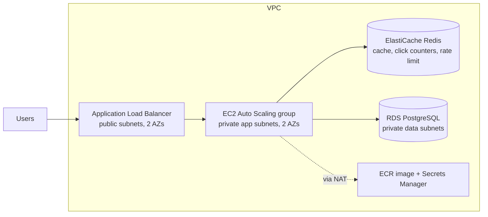

# ShortLink on AWS

A URL shortener built as a highly available, three-tier AWS system. Application code is small on purpose; the point is the architecture, the automation, and the measured behavior under load.

**Stack:** Node.js/Express, PostgreSQL (RDS), Redis (ElastiCache), Docker/ECR, EC2 Auto Scaling behind an ALB, Terraform, GitHub Actions, k6.

## Architecture



Redirect path: `ALB -> app -> Redis` (hit) or `-> Postgres` (miss, then cache). Clicks are counted in Redis and flushed to Postgres in batches, so there is no DB write on the hot path. Full reasoning and trade-offs: [docs/design.md](docs/design.md).

## Run locally

```bash
docker compose up --build
# open http://localhost:8080
curl -s -X POST localhost:8080/api/shorten -H 'content-type: application/json' \
  -d '{"url":"https://example.com"}'
```

Unit tests: `cd app && npm test`

## Deploy to AWS

Prereqs: AWS account, AWS CLI configured, Terraform >= 1.6, Docker.

### 1. (Optional) Remote State Backend (S3 + DynamoDB)
```bash
cd infra/terraform/bootstrap
terraform init
terraform apply
# Follow the output instructions to uncomment the backend "s3" {} block in infra/terraform/versions.tf
cd ..
```

### 2. Infrastructure Deployment
```bash
cd infra/terraform
terraform init

# 1. Create the registry first so there is somewhere to push the container image
terraform apply -target=aws_ecr_repository.app -var-file=example.tfvars

# 2. Build and push the image
ECR=$(terraform output -raw ecr_repository_url)
aws ecr get-login-password --region ap-south-1 | docker login --username AWS --password-stdin ${ECR%%/*}
docker build -t $ECR:latest ../../app && docker push $ECR:latest

# 3. Create everything else (takes ~15 min; RDS is the slow part)
terraform apply -var-file=example.tfvars
terraform output alb_url
terraform output dashboard_url
```

### 3. Teardown
```bash
# Tear down when done to stop AWS billing.
terraform destroy -var-file=example.tfvars
```

**Cost warning:** NAT gateway, ALB, RDS, ElastiCache and 2 EC2 instances are not all free-tier. Expect a few dollars per day while running. Set a billing alarm first, and destroy after every demo session.

## Failure Demos (Run & Inspect)

1. **Kill an app instance:**
   ```bash
   aws autoscaling terminate-instance-in-auto-scaling-group --instance-id <INSTANCE_ID> --no-should-decrement-desired-capacity
   # Watch ALB drop unhealthy target within seconds and ASG launch a replacement.
   ```
2. **Reboot RDS with Failover (requires db_multi_az = true):**
   ```bash
   aws rds reboot-db-instance --db-instance-identifier shortlink-db --force-failover
   # Check app availability: redirects remain served from Redis while DB promotes standby.
   ```
3. **Simulate Redis Outage:**
   ```bash
   # Temporarily revoke Redis port 6379 from the app SG in security.tf, then apply.
   # App automatically degrades to Postgres direct reads without dropping 500s.
   ```
4. **Load Spike & Auto-Scaling:**
   ```bash
   BASE_URL=$(terraform output -raw alb_url) k6 run loadtest/k6.js
   # Watch CloudWatch dashboard: CPU passes 50% threshold and ASG scales 2 -> 6 instances.
   ```

## Load test

```bash
# raise the create-link limit on the app for testing (env var RATE_LIMIT_PER_MIN)
BASE_URL=$(terraform output -raw alb_url) k6 run loadtest/k6.js
```

## Results (fill in with your real measurements)

| Metric | Value |
|---|---|
| Peak sustained req/s | _Run k6 on live deploy to measure_ |
| p95 redirect latency | _Run k6 on live deploy to measure_ |
| Instances at peak (min 2, max 6) | _Run k6 on live deploy to measure_ |
| Time for ASG to scale out | _Run k6 on live deploy to measure_ |
| Cache hit rate | _Run k6 on live deploy to measure_ |
| Monthly cost at idle | _Run k6 on live deploy to measure_ |

## Roadmap

- [x] App with cache-first redirects, async click counting, rate limiting
- [x] Graceful shutdown and distributed request tracing (`X-Request-Id`)
- [x] Terraform: VPC (3 tiers x 2 AZs), ALB, ASG, RDS, ElastiCache, IAM, ECR
- [x] CI (tests, terraform fmt/validate) and deploy workflow (ECR + rolling refresh)
- [x] Passwordless GitHub Actions OIDC deploy role (`github_oidc.tf`)
- [x] HTTPS with ACM + Route 53 custom domain (`dns.tf`, `compute.tf`)
- [x] CloudWatch dashboard and alarms (5xx, latency, CPU, DB connections, Redis) (`monitoring.tf`)
- [x] CloudFront CDN in front of the ALB (`cdn.tf`)
- [x] Remote Terraform state (S3 + DynamoDB lock) (`bootstrap/main.tf`)
- [x] Serverless click-events pipeline (SQS + Lambda + DynamoDB) (`pipeline.tf`, `infra/lambda/`)
- [ ] Live AWS deploy and load test execution (requires live AWS account)
